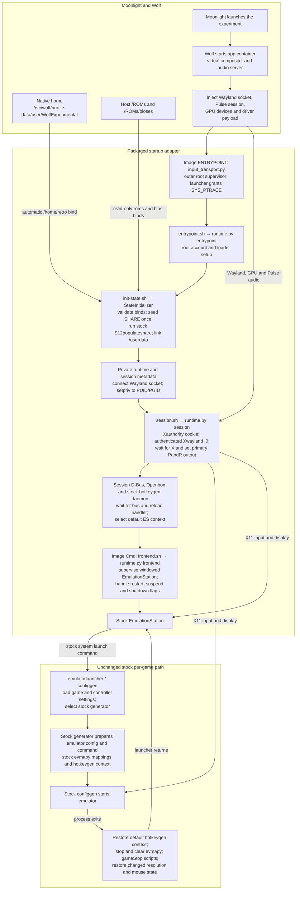
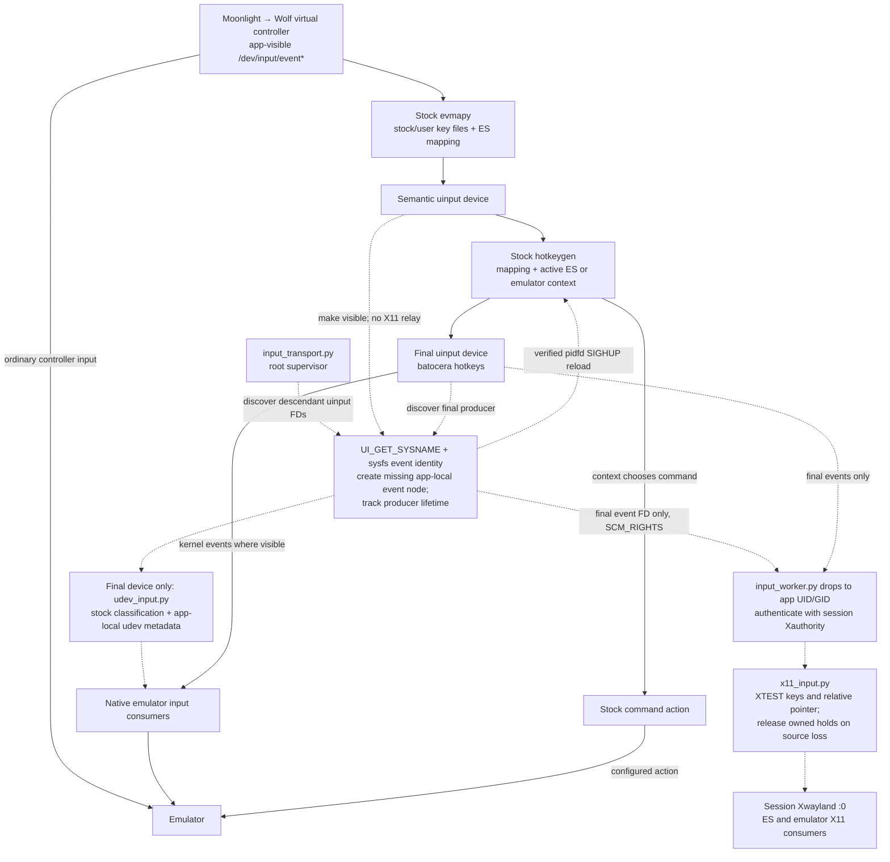

# Full x86 Batocera GoW

Packages the complete official Batocera 43.1 generic x86_64 userspace for games-on-whales, with an Xwayland startup adapter and stock controller-shortcut forwarding. This is not the selectively built GoW runtime.

Project home: [dafrenchyman/batocera-gow-full-x86](https://github.com/dafrenchyman/batocera-gow-full-x86).

Container image: [`ghcr.io/dafrenchyman/batocera-gow-full-x86:latest`](https://github.com/users/dafrenchyman/packages/container/package/batocera-gow-full-x86). The new package currently requires registry authentication; see [publication status](docs/current/app.md) for anonymous access.

- [Setup and commands](#commands)
- [Wolf configuration](#wolf-activation-and-qa)
- [Runtime and input flow](#runtime-flow-on-wolf)
- [Image build flow](#local-image-build)
- [Testing guide](tests/README.md)

## Isolation

Run commands from an independent Git checkout. Downloads stay under `cache/`; builds, manifests and diagnostics stay under `output/`. Cleanup is manual. Do not prune unrelated Docker images, caches or services.

Wolf supplies the app home at `/home/retro`; the adapter links `/userdata` to `/home/retro/userdata`. Keep the runner identity stable to preserve its home, and do not add a manual home bind.

ROMs and BIOS can live in that persistent home or in separate host mounts. Mounts are read-only by default. Writable ROM mounts allow scraping to save media and `gamelist.xml`, but also let the container modify or delete host files. First-run initialization preserves existing libraries. Native verification requires read-only content mounts.

## Commands

```sh
git clone https://github.com/dafrenchyman/batocera-gow-full-x86.git
cd batocera-gow-full-x86
```

Use uv and Python 3.12.x. Image builds also require Docker access, Nix and curl. Docker uses existing socket permissions or passwordless sudo.

On NixOS, select a Nix-provided Python 3.12 interpreter before setup and disable managed interpreter downloads:

```sh
export UV_PYTHON=/absolute/path/to/nix-provided-python3.12
export UV_PYTHON_DOWNLOADS=never
```

From the repository root:

```sh
mkdir -p output/tmp cache
export TMPDIR="$PWD/output/tmp" XDG_CACHE_HOME="$PWD/cache"
uv sync --locked
uv run pytest
uv run batocera-gow-native plan --tier regression
```

`uv sync` installs the application and its host/development dependencies from `pyproject.toml` and `uv.lock`. Python source lives in `src/batocera_gow/`; build inputs and runtime assets live in `build-assets/`. Commands that consume project inputs accept `--project-root`, defaulting to the current directory.

Build locally without publishing or changing Wolf:

```sh
uv run batocera-gow-build --working-tree
```

For a publishable build, use a clean committed checkout:

```sh
uv run batocera-gow-build
uv run batocera-gow-publish --dry-run
```

The default build uses the Git commit as its source identity. `--working-tree` hashes the declared build inputs instead and refuses input changes before promotion. Both modes verify that the complete stock payload and metadata survive packaging. See the [build flow](#local-image-build) for details.

Host configuration comes from command-line options, exported environment, an explicitly selected `--env-file`, then defaults, in that order. There is no automatic dotenv discovery. Use [example.env](example.env) as a template and keep private settings in the ignored `.env`.

To inspect configured media mounts without SSH:

```sh
uv run batocera-gow-media --env-file .env mounts
```

### Qualify an explicitly built image

`batocera-gow-qualify` runs local tests and the independent 80% application-line coverage gate, checks the packaged runtime, then runs native Wolf checks. It requires a current verified build and explicit authorization for the target and shared resource root. It does not build, publish, register an app or restart Wolf.

```sh
uv run batocera-gow-qualify --help
```

Follow the [full-image qualification procedure](tests/README.md#full-image-qualification) for prerequisites, authorization flags and retained reports. Missing media is reported as untested, not as a successful emulator check. Failed checks or incomplete cleanup prevent a passing result.

### Other remote operations

Remote operations require explicit SSH settings and an owned deployment root. These commands publish an image or operate on the configured Wolf host; they are not part of local setup:

```sh
uv run batocera-gow-publish
uv run batocera-gow-remote --env-file .env --deployment-root /srv/batocera-gow --prepare
uv run batocera-gow-remote --env-file .env --deployment-root /srv/batocera-gow --register
uv run batocera-gow-remote --env-file .env --deployment-root /srv/batocera-gow --inspect-session
uv run batocera-gow-remote --env-file .env --deployment-root /srv/batocera-gow --collect-logs
```

Publication verifies an immutable commit tag before updating `latest`. Registry-based preparation uses the recorded publication. `--prepare --local` instead verifies an image already loaded on the target; it does not transfer one.

## Local checks

Default `uv run pytest` selects unit and local integration tests. Builder, packaged-runtime and live-Wolf tests require separate prerequisites and explicit selection. See the [testing guide](tests/README.md) for commands and coverage acceptance.

Run the configured formatting, lint, type and secret checks separately:

```sh
uv run --frozen --no-sync pre-commit run --all-files
```

Hooks can apply formatting and safe fixes. Review their changes. They do not run tests, build images or contact Wolf; initial tool setup can download dependencies. System-tool prerequisites are listed in the [tooling guide](docs/current/tooling.md#local-hook-setup-and-executable-supply). Running checks does not install commit hooks, and `--all-files` omits untracked files.

Review secret findings privately. Do not regenerate `.secrets.baseline` just to silence a finding. A passing secret check is not a history scan or a guarantee that no secrets exist.

## Wolf activation and QA

Set `BATOCERA_GOW_SSH_TARGET` to an OpenSSH alias or a destination such as `tester@192.0.2.10`. `BATOCERA_GOW_SSH_IDENTITY_FILE` is optional; otherwise OpenSSH uses its normal configuration and agent. SSH uses batch mode and strict host-key checking. Private dotenv files and keys are not copied to the target.

Registration manages `Batocera full x86 experiment` under profile `User`, with runner `WolfExperimental`. It refuses activation while a session, lobby or app runner is active, or if the idle query fails. Registration restarts `wolf-wolf-1`; a new session can still race the final idle check. Preserve unrelated apps and persistent homes.

Launch the app through Moonlight and Wolf UI. Check visible EmulationStation, GPU acceleration, heard audio, controller input, reconnect behavior, gameplay and return to the frontend. To check persistence, stop the app's lobby through Wolf UI and start a new one. Disconnecting and rejoining the same lobby is not a persistence check.

Automated diagnostics do not establish client-visible video, heard audio or physical-controller behavior. See [current application state](docs/current/app.md) for deployment records and known verification limits.

### App config.toml

Adapt this block inside the existing profile whose `id = "user"`; do not replace the whole Wolf configuration or create a duplicate profile. The example uses `ghcr.io/dafrenchyman/batocera-gow-full-x86:latest`. For reproducible deployments, replace it with an immutable `ghcr.io/dafrenchyman/batocera-gow-full-x86@sha256:<manifest-digest>` reference. Adjust the Docker-host ROM/BIOS paths for your host. Keep the existing runner name to preserve its persistent home.

```toml
[[profiles.apps]]
title = "Batocera full x86 experiment"
start_virtual_compositor = true
start_audio_server = true

[profiles.apps.runner]
type = "docker"
name = "WolfExperimental"
image = "ghcr.io/dafrenchyman/batocera-gow-full-x86:latest"
mounts = [
  "/ROMs:/home/retro/userdata/roms:ro",
  "/ROMs/bioses:/home/retro/userdata/bios:ro",
]
devices = ["/dev/uinput:/dev/uinput:rwm"]
env = []
ports = []
base_create_json = '''
{
  "HostConfig": {
    "IpcMode": "private",
    "Privileged": false,
    "ShmSize": 2147483648,
    "NetworkMode": "bridge",
    "CapAdd": ["NET_ADMIN", "SYS_NICE", "SYS_PTRACE"]
  }
}
'''
```

Wolf supplies the app home, session sockets, GPU and controller devices. Do not add a host `/dev/input` mount or override the image's entrypoint. The registration tool resolves host mount sources from `BATOCERA_GOW_ROMS_ROOT` and `BATOCERA_GOW_BIOS_ROOT`; Wolf does not interpolate those variables in handwritten TOML. Apply changes while Wolf is stopped or through the idle-gated registration tool.

## Stock shortcut transport

The image entrypoint supervises session-owned uinput devices. It forwards hotkeygen's final output into X11 and publishes stock-classified keyboard metadata for native consumers. Batocera still defines the controller combinations and emulator mappings; there is no replacement hotkeygen or shortcut overlay.

The runner must grant `SYS_PTRACE` for descendant uinput descriptor discovery. Added runtime code is root-owned and not writable by the application account. The runner uses private PID and IPC namespaces, bridge networking and default seccomp. Device-number reuse can still race stale device nodes; this is not strict device-lifetime isolation.

See the [testing guide](tests/README.md) for receiver and emulator checks, and [current application state](docs/current/app.md) for observed behavior and limitations.

## Runtime flow on Wolf

Startup and game launches run through the packaged adapter and unchanged stock configgen. All project helpers live inside the image under `/opt/gow-full-x86`.

The stable image-local shell and `.py` command paths shown below are deliberate thin launchers into `batocera_gow.runtime`, not retained experiment-tree source or a second runtime implementation. They resolve the staged package beneath `/opt/gow-full-x86` without a host venv, development tools or global stock import-path changes.



Before ES starts, the adapter builds the loader cache and sets the session resolution in disposable `/boot/batocera-boot.conf`. Session setup separates NVIDIA bridge/application environments, selects architecture-specific CUDA preloads, normalizes ALSA/Pulse routing and forces SDL/Qt applications onto X11. Emulator children inherit that setup; it is not an added per-game hook.

`runtime.py hotkeys` runs the stock daemon through a narrow startup subclass that ignores only `FileNotFoundError` for unforwarded event nodes. It does not replace the stock executable or change mappings, contexts or action handling.

The root supervisor stays outside that launch path. Below, solid arrows carry ordinary input and dotted arrows show its added discovery, device publication and X11 forwarding. The stock per-game context changes above select hotkeygen's active mapping.



The input supervisor does not interpose between configgen and an emulator: it discovers new devices from descendants while stock launch and cleanup run normally, without hardcoding Guide combinations. Separately, the project-owned [DuckStation wrappers](docs/standards/batocera.md#duckstation-visual-selection-example) apply scoped settings after unchanged stock configgen. Native input depends on the emulator's backend; an emulator need not consume both native and X11 events.

## Local image build

`batocera-gow-build` invokes the installed `batocera_gow.host.build` implementation. Workspace symbols below are `O = output/gow-full-x86`, `A = O/assembly-<assembler-fingerprint>` and `P = O/packaging-<TAG>`. `TAG` is `sha-<full Git commit>` by default or `worktree-<full source SHA-256>` with `--working-tree`. Nothing in this diagram deploys or changes Wolf.

Arrows show build dependencies. The host build runs the steps sequentially.

```mermaid
flowchart TD
  start["batocera-gow-build<br/>Default: clean committed checkout<br/>--working-tree: hash declared build inputs"]
  pin["build-assets/release.json pins official Batocera 43.1 image URL<br/>and compressed-image MD5"]
  download["Reuse cache or curl to .img.gz.partial<br/>Verify pinned MD5; calculate SHA-256<br/>cache/batocera-x86_64-43.1-20260529.img.gz"]
  tools["Resolve debian:trixie to RepoDigest<br/>Build build-assets/builder.Dockerfile<br/>Stock-aligned project Python in isolated /opt/batocera-gow venv<br/>OS interpreter unchanged; record digest and packages"]
  start --> pin --> download
  start --> tools

  subgraph stock["Stock extraction in network-disabled builder; A mounted at /work"]
    disk["Read-only image mount at /inputs/release.img.gz<br/>Recheck MD5/SHA-256; decompress to A/release.img"]
    gpt["Validate GPT bounds, types and overlaps<br/>Require FAT boot + ext4 SHARE<br/>A/partitions.json"]
    fat["mcopy entire FAT partition → A/fat/"]
    layers["unsquashfs both complete roots<br/>A/fat/boot/rufomaculata → A/rufomaculata/<br/>A/fat/boot/batocera → A/batocera/"]
    merge["Reject non-directory collisions<br/>rsync -aHAX --numeric-ids, secondary then main<br/>Merge into A/root/<br/>Reject existing /nix or /opt/gow-full-x86"]
    boot["Copy entire A/fat/ → A/root/boot/<br/>Includes /boot/boot/batocera and rufomaculata<br/>Require /boot absent or an empty real directory"]
    root["Inventory every stock path → A/stock-manifest.json<br/>Archive complete tree → A/stock-root.tar<br/>Keep stock libraries, configgen and init files"]
    share["Read-only guestfish export of ext4 SHARE<br/>A/stock-share.tar<br/>Full seed inventory → A/share-manifest.json"]
    assembly["A/assembly-manifest.json: input/artifact hashes<br/>Retain archives and manifests<br/>Remove decompressed disk and extracted trees"]
    disk --> gpt --> fat --> layers --> merge --> boot --> root
    gpt --> share
    root --> assembly
    share --> assembly
  end
  download --> disk
  tools --> disk

  subgraph bridge["Additive display closure"]
    nix["build-assets/bridge.nix pins nixpkgs commit<br/>Realize Xwayland, xauth, util-linux and Mesa"]
    closure["Query complete transitive Nix requisites<br/>Archive actual nix/store paths → O/bridge.tar<br/>O/bridge-manifest.json: outputs, hashes and size"]
    env["O/bridge.env records exact /nix/store<br/>executable and driver directory paths<br/>GOW_XWAYLAND, GOW_XAUTH, GOW_SETPRIV,<br/>GOW_MESA_DRIVERS"]
    nix --> closure --> env
  end
  start --> nix
  closure -->|"closure size feeds storage bounds"| disk
  runtime["Stage required batocera_gow runtime package and build-assets/runtime assets → O/runtime/<br/>Exclude host/builder modules, venv and bytecode<br/>Copy O/bridge.env → O/runtime/bridge.env"]
  start --> runtime
  env --> runtime

  subgraph package["Packaging in network-disabled builder; P mounted at /work"]
    restore["Extract A/stock-root.tar → P/root/<br/>Compare full stock inventory"]
    addnix["Require bridge entries under nix/store/<br/>Extract O/bridge.tar → P/root/<br/>Result: P/root/nix/store/... → /nix/store/..."]
    addruntime["rsync O/runtime/ → P/root/opt/gow-full-x86/<br/>Includes startup and input transport helpers<br/>Set root:root; remove group/other writes and ACLs<br/>Copy A/stock-share.tar there, mode 0644"]
    gate["Restore stock directory owner, mode and mtime<br/>Compare every stock path again<br/>Only isolated /opt and /nix additions allowed"]
    archive["P/final-root.tar: complete merged root<br/>Numeric owners, ACLs, xattrs and mtimes<br/>P/package-manifest.json: input/archive hashes"]
    restore --> addnix --> addruntime --> gate --> archive
  end
  assembly --> restore
  closure --> addnix
  runtime --> addruntime
  share --> addruntime

  load["ImagePackager streams Docker-save format to docker load<br/>One exact layer: final-root.tar<br/>Candidate image tag uses TAG<br/>ENTRYPOINT: python3 input_transport.py -- entrypoint.sh<br/>Cmd: frontend.sh, all under /opt/gow-full-x86"]
  verify["docker image save → O/verification-*/image-save.tar<br/>Require one layer; unpack and compare every stock path<br/>Check content, type, owner, mode, mtime, xattrs/ACLs,<br/>links, devices and allowed additions<br/>Record inventory-verification.json; remove staging"]
  local["Recheck working-tree inputs before promotion<br/>Tag batocera-gow-full-experiment:TAG<br/>O/build-manifest.json records source identity,<br/>input SHA-256, exact image ID and inventory_verified"]
  archive --> load --> verify --> local
```



The final image contains extracted userspace, not a directly booted disk or a Debian root. SHARE remains `/opt/gow-full-x86/stock-share.tar` until first runtime initialization; the build does not flatten it into `/userdata`. The runtime diagram shows that initialization.

Runtime ownership normalization applies only to the added `/opt/gow-full-x86` tree. Stock metadata remains subject to complete inventory comparison. Cached assembly and packaging require matching input fingerprints and artifact hashes; assembler changes get a separate cache directory.

The shared `batocera_gow.provenance` fingerprint covers contents and relevant modes of `src/`, `build-assets/`, `tests/assets/`, `pyproject.toml`, `uv.lock`, `.python-version` and `.dockerignore`. Successful build manifests record `declared_inputs` and `runtime_inputs` alongside the exact immutable image and stock-verification result. Renamed or changed inputs invalidate affected identities/caches. Historical manifests without complete comparable provenance require an explicit rebuild, not relabeling. Native setup rechecks current inputs before remote preparation, before launch and at completion; drift prevents a passing current-checkout claim.

Docker's context allowlist and builder read-only mounts expose only declared source, build assets, test assets and manifests, never checkout `.env`, `.git` or caches. Explicit host settings are not image/build-context inputs.

The compressed MD5 is pinned; the build records rather than separately pins SHA-256. It does not fetch `checksum_url`. Nixpkgs is commit-pinned. The builder resolves the Debian tag for each invocation and records package versions. The final image uses Docker-save loading, not Dockerfile `ADD`.

## License

Original project contributions are licensed under [LGPL-3.0-only](LICENSE). Image builds include this license at `/opt/gow-full-x86/LICENSE`. Third-party code, assets and bundled components retain their own licenses and notices.
